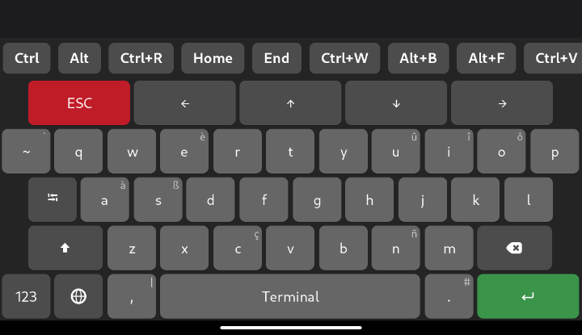

# Arrow keys (and a red ESC) for the Droidian on-screen keyboard

Droidian's on-screen keyboard is **phosh-osk-stub** (Phosh's OSK). Its layouts are
JSON files compiled into the binary as GResource data, and it ships without
cursor keys — painful when editing a command line on a phone.

This adds a row of arrow keys to **every** layout:

```
←  ↑  ↓  →
```

and, in the **terminal** layout, moves the layout's own `ESC` key out of the
second row into that row, at the left and painted red:

```
ESC  ←  ↑  ↓  →
```



## Install

On the phone, from a checkout:

```sh
sudo bash install_wrapper.sh     # dpkg-divert + G_RESOURCE_OVERLAYS wrapper
python3 generate_layouts.py      # writes ~/.local/share/phosh-osk-stub/{layouts,stylesheet}
pkill -f phosh-osk-stub          # phosh restarts the keyboard
```

`generate_layouts.py` must run as the **user** (it writes under `$HOME`), the
wrapper install must run as **root**. The keyboard comes back on its own when
phosh restarts it; otherwise log out/in or reboot.

To remove it again:

```sh
bash restore-stock-osk.sh
```

## How it works

1. `generate_layouts.py` reads every layout embedded in the real binary with
   `gresource extract`, inserts the arrow row at the **top of every level**
   (default, shift, symbols, symbols+shift) and writes the modified JSON to
   `~/.local/share/phosh-osk-stub/layouts/`.

   The row goes to the top on purpose: phosh-osk-stub appends its shift/backspace
   row and its `123`/globe/space/enter row to the **last two** rows of every
   level, so inserting anywhere else breaks those special rows.

   For `terminal.json` the script first removes the layout's `KEY_ESC` key from
   its old position (end of the second row) and re-adds it as the first key of
   the arrow row, with the same width as the arrows and the style class `esc`.

2. `~/.local/share/phosh-osk-stub/stylesheet/common.css` is a copy of the
   stylesheet compiled into the binary with one block appended:

   ```css
   pos-key.esc {
     background: #c01c28;
     color: #ffffff;
   }
   ```

   phosh-osk-stub only knows the CSS classes compiled into it (`sys`, `toggle`,
   `return`), so a local class is needed for the red key. The block is appended
   so it wins over the stock `pos-key` and `pos-key.pressed` rules.

3. `/usr/bin/phosh-osk-stub` is replaced by a small wrapper; the real binary is
   kept at `/usr/bin/phosh-osk-stub.distrib` via `dpkg-divert`. The wrapper
   appends the two overlay prefixes to `G_RESOURCE_OVERLAYS`, so the binary
   reads the generated JSON and CSS instead of the embedded copies. A package
   upgrade lands the new binary at `.distrib` and the wrapper keeps working.

   GResource overlays fall back to the built-in resource when a file is missing
   from the overlay directory, so only `common.css` is generated: the stock
   theme files (`adwaita-dark.css`, `adwaita-hc-light.css`) keep being used and
   both of them `@import` `common.css`, which keeps the red key correct in the
   dark and the high-contrast themes.

## Customising

* **Colour** — edit `ESC_CSS` at the top of `generate_layouts.py`, then re-run it
  and restart the keyboard.
* **Which layouts get the arrow row** — the script adds it to every layout; drop
  the insert from the loop if you only want a few.
* **Arrow size** — `arrow_width()` picks 1, 1.5 or 2 key widths depending on how
  wide the layout is.
* **ESC position/width** — `esc_key()` in the terminal branch.

## Notes

* Tested on Droidian 101 with `phosh-osk-stub` 0.49.0 and phosh 0.47.0
  (Xiaomi "fog", aarch64). The generator reads the layouts from the installed
  binary, so other versions are fine as long as the layout JSON format and the
  `G_RESOURCE_OVERLAYS` mechanism stay the same.
* After a `phosh-osk-stub` upgrade, re-run `python3 generate_layouts.py` so the
  overlay matches the new layouts and stylesheet.
* The keyboard is phosh-osk-stub; this does nothing on Squeekboard setups.
* The arrow keys talk the normal virtual-keyboard protocol (`KEY_LEFT`,
  `KEY_UP`, `KEY_DOWN`, `KEY_RIGHT`), and the moved ESC still sends `KEY_ESC` —
  the modification only changes the JSON layout, never the key codes.

## License

GPL-3.0-or-later, the same license as phosh-osk-stub: the generated layouts are
derived from the layout resources shipped in its binary.
